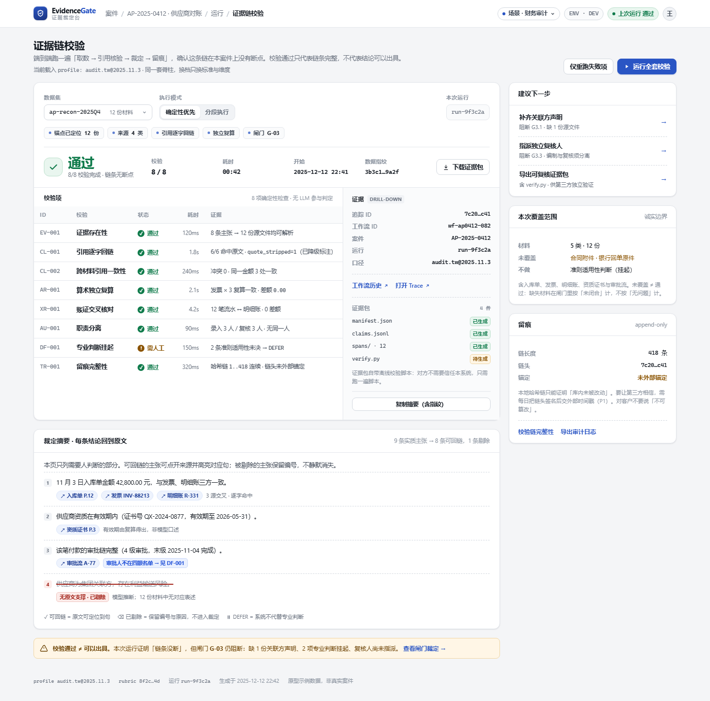
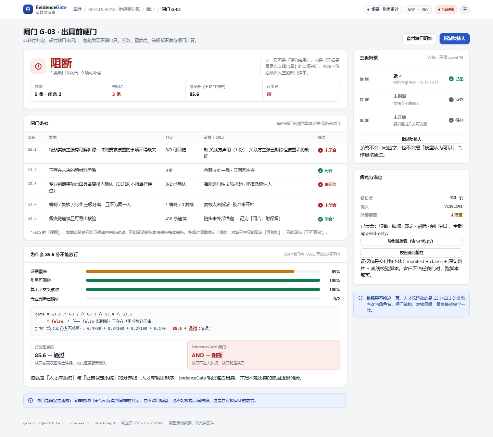

# EvidenceGate 转型提案（v0.1）

> **实施状态（2026-10-19）**：本文 §0 里「仓库里没有 spine.py」是**提案当时**的核对结果；
> 现在脊柱已落地为 `engine/gate/`（IR / 引用核验 / 非补偿闸门 / profiles / 证据包），
> 案件服务在 `engine/cases.py`，证据链校验在 `engine/validation.py`；
> 浅色主题（深色保留）与「案件 / 证据链」两页已接进 `viewer/`。
> 落地过程中的偏差与未完成项见文末 [§9 实施记录](#9-实施记录)。

> **一句话**：把「人才库」从产品降级为一个 profile，把「证据 → 裁定 → 闸门 → 留痕」升为产品；UI 从深空星图换成纸白仪表盘。
> 但在动 UI 之前，得先接受一个事实：**本仓库里没有 `spine.py`**——转型的第一步不是写页面，而是把数据模型从「候选人」改成「主体」。

---

## 0. 先说三句结论

1. **方向是对的。** WorkBuddy 的「领域无关脊柱 + 可插拔 profile」判断成立，而且你手上的 `fence.py`（定界防注入）、`rubric.py`（口径哈希）、`audit`（哈希链）、`runs/run_events`（运行状态）确实是可复用的硬资产——这些不是换皮能换出来的。
2. **但「已落地三个文件」不成立。** 我逐项查了：`engine/` 下没有 `spine.py` / `orchestrator.py` / `profiles/`，`docs/` 下也没有 `REFERENCE_LANDSCAPE.md` / `DISTINCTIVE_DESIGN.md`。所以现在不是「Phase 0 已完成」，而是「Phase 0 还没开始」。**不要在一个不存在的契约上排 Phase 1**——那样只会得到一份更漂亮的提示词。
3. **真正的转型成本在数据模型与状态机，不在 prompt，也不在配色。** UI 是转型里最快能看到、也最容易骗自己的部分：把深色调成浅色，看起来像新产品了，但 `candidates / people / outcomes / calibration` 这套表还是只认「候选人」。

---

## 1. 现状核对：哪些能复用，哪些是隐形耦合

| 资产 | 位置 | 领域无关？ | 转型处置 |
|---|---|---|---|
| 材料定界 + 注入检测 | `engine/fence.py` | ✅ 完全无关 | 原样搬，nonce 机制不变 |
| 口径哈希 + 温度签名 | `engine/rubric.py`、`agents.py` | ✅ 完全无关 | 扩成 `profile_version`，让「换场景 = 换尺子」体现在版本号里 |
| 审计哈希链 | `engine/db.py` → `audit(prev_hash, hash)` | ✅ 机制无关 | 保留，补「外部锚定」与「可导出的离线校验」 |
| 运行与事件 | `runs` / `run_events` | ✅ 机制无关 | `run` 泛化为「一次取证-裁定执行」，字段里的 `candidate_ids_json` 换成 `subject_ids_json` |
| 模型客户端 / 温度纪律 / 成本 | `engine/llm_client.py` | ✅ 无关 | 原样保留（辩论 0.7、裁定与评分 0） |
| 身份多信号解析 | `engine/identity.py` | 🟡 半无关 | 「同名合并」≈「同一主体/关联方识别」，抽成通用 entity resolution，但保留「姓名不计为证据」这条踩坑规则 |
| 隐私与删除 | `engine/privacy.py` | ✅ 无关，但更严 | 审计场景要考虑底稿保管年限，retention 必须进 profile |
| 候选人 / 人 / 结果 / 标定 | `candidates`、`people`、`outcomes`、`calibration_*` | ❌ 领域锁定 | 新增通用 `subjects / cases`，talent 走 adapter 双写 |
| 评分维度与等级 | `util.DIMENSIONS`、A/B/C | ❌ 领域锁定 | 迁进 `profiles/talent/` |
| 三位评委人设 / 提示词 | `agents.py` 常量 | ❌ 领域锁定 | 迁进 `profiles/talent/` |
| 前端四视图 | `viewer/`（岗位/人才库/分析/管理） | ❌ 领域锁定 | 换成「案件/运行/证据/闸门/留痕」，talent 视图作为 profile 皮肤 |

**结论**：能复用的是**机制**（定界、哈希、版本、运行、成本），不能复用的是 **schema 与语义**。所谓「100% 复用」是幻觉；可复用的代码不少，但数据契约必须重写。

---

## 2. 对 WorkBuddy 方案的四点修正（+ 一个补充）

### 2.1 领域无关的边界画错了：不是 prompt，是 IR 和状态机

「把『录用/淘汰』从提示词里拿掉」只解决了措辞。真正的领域锁定在：

- `candidates` 表：一个案件只有一个「候选人」主体，审计里一个案件可能有多主体（供应商、审批人、关联方）；
- `outcomes` 与「真实进展回填」：审计没有「录用结果」这个 ground truth；
- A/B/C 分档与「中位数聚合」：审计要的不是排序，而是**能不能出具**（二值 + 缺口清单）。

**建议**：先定义领域无关的中间表示（IR），profile 只做映射，不拥有流程。

```python
# 概念签名（不是最终代码）
Subject      # 被裁定的对象：候选人 / 供应商 / 一笔费用 / 一个合同
Case         # 一次裁定的边界：材料集合、标准版本、责任人
Artifact     # 原始材料：role, sha256, 页数, 解析器版本
EvidenceRef  # (artifact_id, sha256, page, char_start, char_end, quote) ← 必须有 span
Claim        # 一条可被证伪的论断：text, stance, citations[], status
Finding      # 校验/裁定产物：code, severity, status, citations[], reasoning
Verdict      # 案件级结论：pass / block / needs_human + findings[]
GateResult   # 闸门判定：clauses[], blocking[], evaluated_at, hash
TrailEvent   # append-only：actor, action, target, payload_hash, prev_hash, hash
```

关键一条：**`EvidenceRef` 必须带字符级 span**。只记「引用自发票 P.12」不叫回链——无法定位到句，就无法机器核验，也无法在原文里高亮。

### 2.2 非补偿闸门必须写成「数据 + 纯函数」，而且要有第三态

WorkBuddy 说「缺证据/未决矛盾/需人判 → 红灯」，方向对，但没给规格。落地必须满足：

- **条款是数据**，不是 `if`：`{code, requirement, predicate, evidence_required, severity, applies_to}`，随 profile 版本化；
- **闸门是纯函数**：输入 `findings + coverage`，输出 `PASS / BLOCK / NEEDS_HUMAN`，不调用 LLM，不读时钟（时间由外部传入）；
- **第三态**：`UNKNOWN` 不允许被折叠成 `PASS`。「材料没给」记「未闭合」，不记「无问题」——这条决定系统是审计工具还是安慰剂；
- **可复现**：同一输入跑 100 次，`GateResult.hash` 必须完全一致。这是「可被审计」的最低门槛。

### 2.3 哈希链 ≠ 不可篡改，必须外部锚定

`audit` 表用 `prev_hash` 串起来，只能证明「库内这几行没被单独改动」。整库替换后重算一条链，验证照样通过。

- 最小可信做法：每日把链头 hash 做签名（Ed25519）+ 可信时间戳（RFC 3161），或落地到第三方 WORM；
- 导出证据包时带 `verify.py`：对方不信任你，也能自己验；
- **话术纪律**：对客户只能说「可核验、可追溯」，不能说「不可篡改」。README 里已经写过「单向哈希链，任何一行的篡改都会让链校验失败」——这句在技术上没错，但在商务语境里会被读成「不可篡改」，建议改成「可检出篡改」。

### 2.4 人才库不能「一步降级」，要双写期

现有 API、DB、前端都是候选人形状（`candidates`、`outcomes`、`calibration_items`、`/api/candidates/:cid/...`）。一次性重写，风险最高的恰恰是留痕与历史分数——而你最不该弄丢的就是这两样。

**建议**：v9 迁移只**新增**通用表（`cases`、`subjects`、`claims`、`findings`、`gate_results`），talent profile 双写 1–2 个版本；前端加「场景」开关；等新链路在自己的测试里稳定，再谈删旧表。

### 2.5 补充一个他们没说的：每个 profile 必须自带 gold set

换场景后，你拿什么回答「是不是变差了」？答案是**标注样例**：20–50 条（含「应当被剔除」的负例），跑同一套指标（引用命中率、误剔除率、闸门一致率）。没有这个，转型就是不可证伪的。

`tests/fixtures/sample_set_v1.json` 和现有标定集可以升级成 talent 的第一份 gold set。

---

## 3. 建议架构

```
┌────────────────────────────── UI（浅色 / 可打印） ──────────────────────────────┐
│  案件台   运行详情   证据浏览器   闸门与裁定   留痕与导出        设置（profile）  │
└───────────────────────────────────┬──────────────────────────────────────────────┘
                                    │ HTTP（同一套 API，场景由 profile 决定）
┌───────────────────────────────────▼──────────────────────────────────────────────┐
│  Governance：闸门引擎（纯函数）/ 三级复核 / 证据包导出 / 链锚定 / 权限与隔离      │
├──────────────────────────────────────────────────────────────────────────────────┤
│  Spine：IR + 流程（Resolver → 主张 → 对抗/取证 → 核验 → 裁定 → 聚合）            │
│         确定性节点：解析、哈希、复算、引用核验、闸门、留痕（不经过 LLM）          │
├──────────────────────────────────────────────────────────────────────────────────┤
│  Profile：talent / expense / contract …（标准库、维度、阈值、门控条款、报告模板） │
├──────────────────────────────────────────────────────────────────────────────────┤
│  Ingress：上传 / 解析 / 定界防注入 / 角色识别 / 加密落库（复用现值）              │
└──────────────────────────────────────────────────────────────────────────────────┘
```

```python
# engine/gate/profiles/base.py —— profile 契约（草案）
class Profile(Protocol):
    key: str                      # "talent" | "expense" | "contract"
    version: str                  # 进 rubric_version：换标准 = 换尺子
    subject_kind: str             # "candidate" | "supplier" | "expense_claim"
    artifact_roles: tuple[str, ...]

    def extract(self, artifacts) -> list[Claim]: ...
    def stances(self) -> tuple[Stance, Stance]: ...          # 正/反方话术
    def judges(self) -> list[JudgeSpec]: ...                 # 人设与维度映射
    def criteria(self) -> list[Criterion]: ...               # 每条带 source 引用
    def gate(self) -> list[GateClause]: ...                  # 门控条款（数据）
    def severity_map(self) -> dict[str, str]: ...
    def report(self) -> ReportSpec: ...
    def retention(self) -> RetentionPolicy: ...
```

---

## 3.5 Agent 排布：骨架同意，但改三处

WorkBuddy 给的链路（Resolver → 正/反 → 裁定 → Verifier → 3 评委 → 中位数 → Gate → 三级复核 → Trail）**骨架可用**，但有三处会让它在审计场景里失真：

**改 1：核验要「边走边验」，不能只在裁定后验。**
如果 Verifier 只接在裁定之后，裁判拿到的是一批可能已被幻觉污染的主张，它只能「整理」，不能「止损」。正确顺序是：每条 `Claim` 生成即做一次廉价的确定性核验（span 是否存在、quote 是否逐字命中、数字是否复算一致），核验失败的 claim **在进入辩论前就被标 `unsupported`**；裁定后再做一次批量审计（查漏、查跨材料矛盾）。两层核验，成本不同、目的不同。

**改 2：评委数量应由 profile 决定，审计场景不需要 3 个「打分」评委。**
人才筛选要的是排序，所以 3 视角 + 中位数有意义（尽管你已经诚实说明它们不独立）。审计要的不是排序，是「能否出具」：3 个同源 LLM 评委只会制造「看起来有共识」的假象。审计 profile 应该把评委降到 1（或 0），把预算花在**多来源交叉核对**（账 ↔ 证 ↔ 审批 ↔ 合同）上。

**改 3：缺一个「缺失发现器」（Gap Finder），而它恰恰是审计的核心。**
正/反辩论找的是「材料里说了什么、有没有矛盾」，但审计最大的风险是**材料里没说什么**：没有关联方声明、没有验收单、没有回函、没有审批。这类「应有但未提供」的缺口，靠辩论永远发现不了——因为双方都只能引用已存在的东西。所以需要一个独立角色：拿 criteria 里的「必需证据清单」去比对 `Artifact` 的角色与覆盖率，输出 `MissingEvidence` 列表，直接喂给闸门 G3.1。人才 profile 里它可以退化为「缺项提醒」（如缺离职证明），并不突兀。

| 角色 | 实现 | 温度 | 领域无关 |
|---|---|---|---|
| Resolver（材料 → 结构化事实 + 实体） | 规则 + LLM 抽取 | 0.1 | ✅ |
| Claim Extractor（主张 + 引用 span） | LLM | 0.2 | ✅ |
| 正方 / 反方 | LLM，话术来自 profile | 0.7 | 🟡 话术进 profile |
| 裁定裁判（整事实、剔幻觉、不判倾向） | LLM | 0.0 | ✅ |
| **Verifier（span / 逐字 / 复算）** | **确定性代码** | — | ✅ |
| **Gap Finder（应有未提供的证据）** | 规则 + LLM 归纳 | 0.0 | 🟡 清单来自 criteria |
| 评委（数量由 profile 定） | LLM | 0.0 | 🟡 维度进 profile |
| 聚合（中位数 / 严重度） | 确定性 | — | ✅ |
| 闸门 | 确定性纯函数 | — | ✅ |
| 三级复核 | **人** | — | ✅ 流程 |
| Trail | 确定性追加 | — | ✅ |

一句话：**LLM 负责「找」，确定性代码负责「验」，人负责「签」。** 三者不能互相顶替——这是审计系统和「AI 分析工具」最本质的区别。

---

## 4. 第二个场景怎么选

选型不看「哪个行业热」，看六个可判定的维度（1–5 分）：

| 维度（权重） | 费用报销合规 | 采购 / 合同条款 | 人事合规 | 财报审计（IFRS/CAS） |
|---|---:|---:|---:|---:|
| 材料可得性（25%） | 5 | 5 | 4 | 2 |
| 标准可枚举（20%） | 5 | 4 | 3 | 3 |
| 证据密度：每条结论都有源（20%） | 5 | 5 | 3 | 4 |
| 责任可分离：编制/复核/批准（15%） | 5 | 4 | 4 | 5 |
| 演示与数据构造成本（10%） | 5 | 4 | 3 | 1 |
| 失败代价可控（10%） | 4 | 4 | 3 | 2 |
| **加权总分** | **4.9** | **4.5** | **3.4** | **3.0** |

**推荐：费用报销合规作为 profile #2，采购/合同作为 #3，财报审计放到最后（只做「演示壳」）。**

理由：报销的证据结构最干净（发票、审批流、制度条款、金额），复算与交叉核对都能确定性完成，「同一张发票重复报销」「超标」「缺审批」这些缺口天然适合非补偿闸门；而且它与人才库零语义重叠，能真正证明「脊柱是领域无关的」。财报审计不是不好，是它的准则判断与数据门槛会把转型拖进专业审计领域——那是另一个产品。

**明确不做**：SOC2/ISO 体系认证（要现场审计）、实时交易反欺诈（延迟要求）、法律意见书（执业资质）。

---

## 5. UI 提案

### 5.1 浅色不是审美选择，是介质选择

审计/复核结论的最终介质是**打印、投影、PDF、共享屏幕**。深色在这四种介质里全是负资产：打印费墨、投影发灰、PDF 分享后对比度崩、截图贴进汇报文档像截图事故现场。

但浅色 ≠ 全白。需要三层纸面（画布 / 卡片 / 分隔线）+ **一个只指向证据的强调色**，否则所有元素一样重，等于没有层次——这恰好是「清晰可见」的反面。

### 5.2 六条设计原则

1. **纸白底 + 单一强调色**：蓝色只用于「可追溯的东西」和主操作，不做装饰。
2. **状态三件套**：图标 + 文字 + 颜色，永远同时出现（色盲、黑白打印、投影偏色下都可读）。
3. **结论旁边就是证据**：引用以行内 chip 出现，点开在原文高亮对应句，而不是「去另一个页面找」。
4. **被剔除的东西必须可见**：删除线 + 原因 + 保留编号，禁止静默消失。
5. **密度分层**：运行页密（给工程师与复核人）、案件台疏（给业务）、闸门页只回答「能不能出具」。
6. **可打印是一等公民**：A4、分页不切卡片、页脚带指纹与口径版本。

### 5.3 设计 token（已落成 `design/light/theme.css`）

| 用途 | 变量 | 值 | 对比度（白底） |
|---|---|---|---|
| 画布 | `--canvas` | `#F4F5F7` | — |
| 卡片 | `--surface` | `#FFFFFF` | — |
| 分隔线 | `--line` | `#E4E7EC` | — |
| 主文字 | `--ink` | `#141A22` | 17.5 : 1 |
| 次文字 | `--ink-2` | `#3D4653` | 9.6 : 1 |
| 辅助文字 | `--muted` | `#69717E` | 4.9 : 1 |
| 强调 / 链接 | `--accent` | `#2A55C4` | 6.6 : 1 |
| 通过 | `--ok` | `#0E7A4A` | 5.4 : 1 |
| 待人工 | `--warn` | `#8A5300` | 6.3 : 1 |
| 阻断 | `--bad` | `#A32319` | 7.5 : 1 |
| 信息 | `--info` | `#1D4ED8` | 6.7 : 1 |

全部 ≥ WCAG AA 4.5:1；`--faint #8A929E`（3.1:1）只允许用在「非必要、可忽略」的信息上（如示例数据标记），不承载结论。

### 5.4 页面 IA（同一套 IA 跨场景）

| 页面 | 回答的问题 | 主要元素 |
|---|---|---|
| 案件台 | 我手上有哪些案子、卡在哪 | 案件列表、缺口数、待我签 |
| 运行详情 | 这条证据链有没有断 | 校验表 + 证据栏 + 裁定摘要（见原型 1） |
| 证据浏览器 | 这条结论的原文在哪 | 原文 + 高亮 span + 剔除层 + 上下文 |
| 闸门与裁定 | 能不能出具、缺什么 | 条款表 + 非补偿说明 + 三级签字（见原型 2） |
| 留痕与导出 | 谁在什么时候改了什么 | 链、锚定状态、证据包、verify.py |

### 5.5 与参考截图的元素映射

| 截图（Engram / Golden Thread） | EvidenceGate | 为什么改 |
|---|---|---|
| Engram 品牌 | EvidenceGate | 品牌换，结构留 |
| Navigator / Validation / Golden Thread | 案件 / 运行 / 证据链校验 | 审计用户的心智单位是「案件-运行-证据」，不是「导航-验证-金线」 |
| `ENV: DEV` | `ENV · DEV` + `profile 版本` | 对结论影响更大的是口径，不是环境 |
| `Last run: PASS` | `上次运行 通过` | 保留 |
| `Run suite` / `Re-run failed` | 运行全套 / 仅重跑失败项 | 保留 |
| Dataset 下拉 | 数据集（材料集） | 保留 |
| Deterministic / Segmented | 确定性优先 / 分段执行 | 保留，并标注「无 LLM 参与判定」 |
| 标签行（Anchors detected…） | 锚点 / 来源 / 回链 / 复算 / 闸门 | 让「这条链做了什么」一眼可见 |
| `PASS 8/8` + 四项统计 | 通过 + 8/8 + 数据指纹 | 指纹比开始时间更能证明「同一批材料」 |
| `Download evidence` | 下载证据包 | 证据包就是交付物 |
| Checks 表 | 校验项表 | 新增「需人工」状态，允许非全绿 |
| Evidence (drill-down) | 证据栏（Trace / 包 / 复制摘要） | 保留，补「证据包四件」 |
| Narrative（带引用） | 裁定摘要（claim + 引用 + 删除线） | 把「叙述」变成「可核验主张」 |
| Recommended next actions | 建议下一步（每条绑定一个闸门缺口） | 动作必须有后果，不能是装饰性建议 |
| Warnings | 诚实边界 / 留痕保留 | 把「不知道」和「没锚定」写出来 |

### 5.6 两张原型

**原型 1 · 运行详情**——对应截图的主页面，浅色重做，并保留「非全绿」的诚实状态：



**原型 2 · 闸门裁定**——把「分数不能补偿缺口」可视化，是这套系统与「打分型系统」的分界线：



可直接打开：`design/light/run-suite.html`、`design/light/gate.html`（无构建、无依赖，`theme.css` 即完整 token 与组件样式）。

### 5.7 交互细节（容易被忽略、但决定可信度）

- **证据抽屉**：右侧 420px，原文 + 高亮 span + 前后各 2 段上下文 + 「复制带定位的引用」（含 `#p12` 与字符区间）。
- **剔除可展开**：点「已剔除」看到模型原话与「为什么被判无据」（12 份材料中无对应表述）。
- **DEFER 要选人**：「挂起」不是一个状态，是一次指派动作；没人认领就一直阻断。
- **签字不可撤销**：复核/批准需要二次确认，撤销只能是「作废 + 重签」，并写进链。
- **键盘与读屏**：表格有 caption，状态有 `aria-label`，焦点环 2px，弹层焦点陷阱。

### 5.8 不要做的事

玻璃拟态 / 霓虹渐变 / 星空背景 / 巨大 KPI 数字墙 / 把「综合分」做成主视觉。这些在 demo 里很抓眼，在审计场景里会被读成「不严肃」。

---

## 6. 路线与验收（可测，不是口号）

| 阶段 | 内容 | 验收标准 |
|---|---|---|
| **P0**（约 1 周） | IR + v9 迁移（只新增表）+ profile 注册 + talent adapter 双写 | 现有测试全绿；旧数据可回填且计数一致；同输入下 talent 输出与改造前一致（分数、剔除集合、`rubric_version`） |
| **P1**（约 2 周） | 引用核验层、闸门引擎、证据包导出 + `verify.py`、浅色 UI 两页 | 闸门同输入 100 次哈希一致；构造 50 条伪引用，召回 100%、误杀 0；离线机器跑 `verify.py` 能检出改 1 字节；两页在 1440 / 1024 / A4 打印下无溢出且 AA |
| **P2**（约 2–3 周） | 第二个 profile（费用报销）+ gold set（30 条）+ 三级复核 + 外部锚定 | 接入新 profile **不修改** `gate/spine.py`；gold set 有基线指标；锚定可被第三方独立验证 |
| **P3** | 多租户、保留期与删除、移动端只读、报告模板 | 按客户需求排 |

**顺序上的硬约束**：P0 的 IR 必须先于 UI。否则你会把浅色样式落在一个朝夕要改的数据结构上，返工两次。

另外：动手前先把当前未提交的面试录音改动（`git status` 显示 30+ 个文件）落成一个提交。迁移 diff 与功能 diff 缠在一起，回滚时会互相牵连。

---

## 7. 风险与诚实边界

| 风险 | 具体表现 | 缓解 |
|---|---|---|
| 过度承诺 | 对外说「自动审计」「不可篡改」 | 话术清单：可说「可核验/可追溯/可复现」，不可说「不可篡改/自动定论」 |
| 两个场景同时铺 | 标准库烂尾，两边都只有 demo | 先深后广：talent 保兼容，第二个 profile 做透再开第三个 |
| 成本与延迟 | 每条材料都过 LLM | LLM 只负责「找主张」；核验、复算、闸门、留痕全部确定性 |
| 专业判断越界 | 模型对准则适用性下结论 | 强制 `DEFER`，并让「没人确认」成为阻断项 |
| 合规 | 底稿保管年限、个人信息、跨境 | retention 进 profile；审计日志与删除流程复用现有隐私模块 |
| 命名 | 「EvidenceGate」已被若干 hackathon 项目与小包使用（[PDX EvidenceGate](https://devpost.com/software/pdx-evidencegate)、[evidence-gate on PyPI](https://pypi.org/project/evidence-gate/)、[同类演示](https://harsh-choksi.github.io/EvidenceGate/)） | 不阻塞开发；若商业化，注册前查商标与域名，必要时加限定词（如 EvidenceGate Audit） |

---

## 8. 需要你拍板的三件事

1. **第二个试点**：我推荐「费用报销合规」（理由见 §4）。若你更想打「合同/采购」或「人事合规」，说一声，标准库的设计会完全不同。
2. **迁移方式**：接受「talent 降级为 profile + 双写期」，还是要求一次性重写？前者慢但稳，后者快但会碰历史分数与留痕。
3. **UI 落地**：直接把 `viewer/` 换成浅色（深色删除），还是浅色为默认、深色保留为可选主题？我倾向后者——演示时深色仍有冲击力，但默认必须是浅色。

你定完这三件，我再动 `engine/`。**在此之前我没有改任何引擎代码**：本提案只新增了 `docs/EVIDENCEGATE_BLUEPRINT.md` 与 `design/light/`（原型 + token），现有应用行为不变。

---

## 9. 实施记录

### 9.1 已落地（与本提案的对应关系）

| 提案里的东西 | 实际文件 | 说明 |
|---|---|---|
| 领域无关 IR | `engine/gate/ir.py` | `Claim / EvidenceRef / Artifact / Finding / Approval / TrailSnapshot / Case` |
| 引用核验 | `engine/gate/verify.py` | NFKC + 空白归一、指纹比对、字符区间校验、算术复算 |
| 非补偿闸门 | `engine/gate/gate.py` | 条款是数据、求值是纯函数；`pass / fail / needs_human` 三态 |
| 场景 profile | `engine/gate/profiles/` | `talent`（3 评委）与 `expense`（1 评委）；注册即扩展 |
| 证据包 | `engine/gate/bundle.py` | zip 内固定时间戳，同输入同字节；自带离线 `verify.py` |
| 案件持久化 | `engine/cases.py` | v9 新增 6 张表；材料正文 `enc:v1:` 加密 |
| 证据链校验 | `engine/validation.py` | 8 项检查，允许 `warn`，总状态由逐项推导 |
| API | `engine/api.py` | `/api/profiles`、`/api/cases…`、`/api/validation/golden-thread` |
| 浅色 UI | `viewer/styles.css` + `viewer/evidence.css` | 默认浅色，`styles-dark.css` 保留深色 |
| 新页面 | `viewer/index.html` + `app.js` | 案件（默认）/ 证据链 / 案件详情 |

### 9.2 与提案不一致的地方（都是实现时才发现的具体问题）

1. **签署角色不是通用的 maker/checker/approver**。talent 用这三个词没有歧义，
   但报销场景里「编制人」其实是报销人（claimant）。现在角色由 profile 的
   separation 条款声明，闸门只检查「角色齐、签署人互不相同」。
2. **字符区间（char_start/end）是可选校验**，不是强制。强制要求每份解析器都给
   准确 offset，会给 docx/pdf 解析带来大量误报；当前策略是「给了就校验，没给就查引文」。
   代价是：引用能找到句，但不一定能精确高亮——这一点写在了 `verify.py` 的注释里。
3. **第二试点选了费用报销**（提案 §4 的推荐），没有做财报审计。两个 profile 的
   `gate.py` 是同一个文件，测试 `test_cases.py` 里同一条断言分别跑 talent 与 expense。
4. **主张的写入暂未接 LLM 自动抽取**：UI 提供「追加材料 / 追加主张」表单，演示脚本与
   API 直接写入。这是有意的——先把「核验 + 闸门 + 留痕」这条链做实，
   再决定抽取器用哪套提示词，免得又回到「提示词驱动、无法验证」的老路。

### 9.3 新增测试与当前状态

- `tests/test_gate.py`（52 项）：IR 可复现、引用核验 6 种失败、非补偿（堆 10 条漂亮主张仍阻断）、
  三态、100 次同 hash、证据包离线校验 + 篡改检出。
- `tests/test_cases.py`（35 项）：建案、材料加密落库、角色白名单、引用不存在被拒、
  阻断→签署→补齐→通过、结论过期拒绝导出、删除级联、8 项校验、talent/expense 同脊柱。
- 全量测试（含 e2e 101 / 验收 48 / 对齐 33+33 / 规模 18 / ASR 39 / 归属 63）全部通过。

### 9.4 仍然没做的（别在汇报里含糊）

- **外部锚定**：链头仍未签名/时间戳化。校验页明确显示「未锚定」，证据包 manifest 也写明
  「未签名」。对外只能承诺「可核验」。
- **多租户与保留期**：案件沿用了单库单租户模型；retention 还没进 profile。
- **移动端**：证据链页做了 1100/720 两档断点，案件详情在手机上仍偏挤；
  审计场景的主介质是桌面/打印，这一项优先级低。
- **合同 / 采购条款 profile**：没写，留给第三个场景。

### 9.5 追加：控制台（门户）与分系统边界

原来的顶层导航把「岗位 / 人才库 / 分析」和「案件 / 证据链」挤在一排，
表达的是"一个系统有几页"，而不是"这是几个分系统"。按产品定位改成：

- **控制台**：EvidenceGate 居中，下面是分系统卡片（人才筛选、案件与证据、证据链校验为已上线；
  规则审查、交叉核验、审查工作流、审计与分析、接入与集成为待补充）。
  这是登录后的默认落点。
- **顶层导航只剩跨系统入口**：控制台 / 案件 / 证据链 / 管理。业务页签不再上浮。
- **人才筛选分系统**：有自己的子导航（岗位 / 人才库 / 分析）与「↗ 新窗口」；
  `?sys=talent` 可直接从新窗口落到子系统，`← 返回控制台` 回到门户并洗掉 URL 参数。

取舍：没有做成多个独立 HTML 应用，避免共享登录态、数据库、审计链被复制三份；
"独立窗口"用同一 SPA + 子系统壳实现，新窗口只改变落地页。
